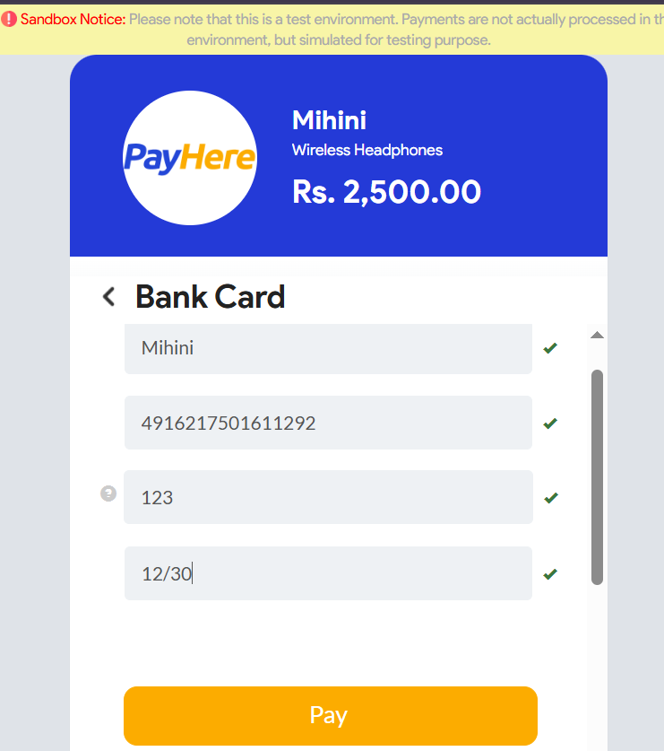
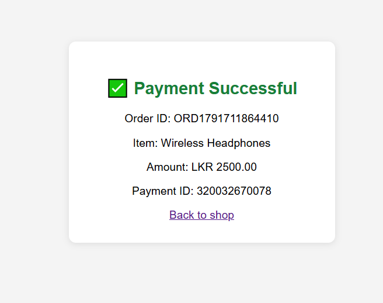
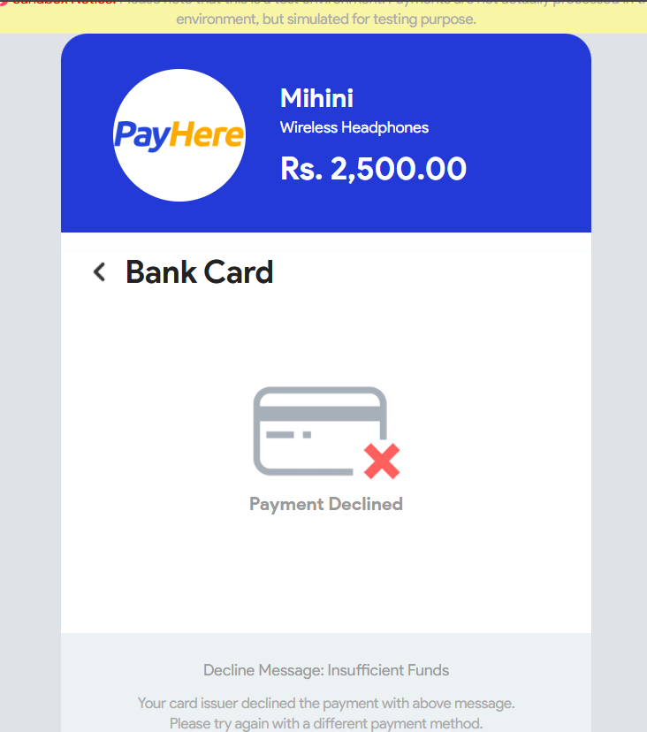
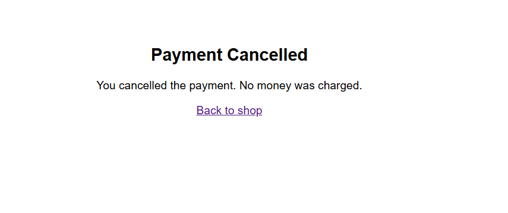
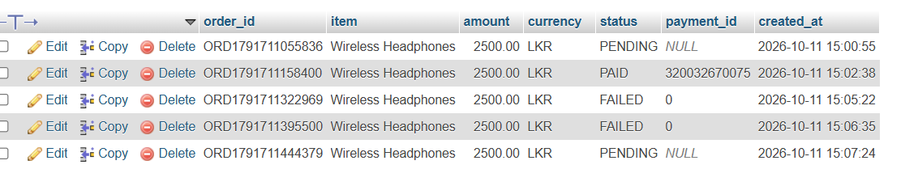

# PayHere Payment Demo

This is a small project I made to learn how a payment gateway works. I used PayHere because it is used by a lot of websites in Sri Lanka.

It is a simple shop page with one product. When you click "Buy Now" it goes to the PayHere payment page, and after paying it comes back and shows if the payment was successful or not.

Everything runs in **sandbox mode**, so no real money is used. You pay with test cards.

## What I used

- PHP
- MySQL (with PDO)
- XAMPP
- ngrok
- PayHere Sandbox

## How it works

1. The user clicks **Buy Now** on the product page (`index.php`).
2. `checkout.php` saves the order in the database as `PENDING`, makes the hash and sends the user to PayHere.
3. The user pays on the PayHere page.
4. PayHere sends the payment result to `notify.php`. This file checks if the message really came from PayHere and then updates the order status in the database.
5. The user comes back to `return.php`, which reads the status from the database and shows it.

```
index.php -> checkout.php -> PayHere page -> return.php
                                  |
                                  +-> notify.php (updates the database)
```

## Things I learned

- The hash has to be made on the server. If you make it with JavaScript, anyone can see the merchant secret.
- You should not send the price from the browser, because someone can change it with Inspect Element. So the price is taken from the server.
- PayHere does not send the payment status to the return page. You have to wait for `notify.php` and then read it from the database.
- `notify.php` does not work on localhost because PayHere's server can't reach my laptop. I used ngrok to get a public URL for it.
- In `notify.php` I check the `md5sig`, the merchant ID and the amount before marking an order as paid, so nobody can send a fake "payment success".
- PayHere sandbox does not accept subdomains (like ngrok links), so I registered `localhost` as the domain and only used the ngrok link for the notify URL.

## How to run it

1. Install XAMPP and put this folder inside `htdocs`.
2. Start Apache and MySQL.
3. Open phpMyAdmin and run `database.sql` to make the database.
4. Make a PayHere sandbox account at https://sandbox.payhere.lk and add `localhost` as a domain in **Integrations**.
5. Copy `config.example.php` and rename it to `config.php`. Put your merchant ID and merchant secret in it.
6. Run ngrok:
   ```
   ngrok http 80 --url https://your-domain.ngrok-free.dev
   ```
7. Put your ngrok link in `public_url` in `config.php`.
8. Open `http://localhost/payhere-demo` and click **Buy Now**.

## Test cards

You can use any name, any CVV and any future expiry date.

| Result | Card number |
|---|---|
| Success (Visa) | 4916217501611292 |
| Success (Mastercard) | 5307732125531191 |
| Insufficient funds | 4024007194349121 |
| Do not honor | 4929768900837248 |

These are test cards from the PayHere docs. They only work in sandbox.

## Screenshots

### Product page


### PayHere checkout


### Payment successful


### Payment failed


### Payment cancelled


### Orders in the database


## Note

`config.php` is in `.gitignore` because it has my merchant secret. Please don't upload your own `config.php` to GitHub.
